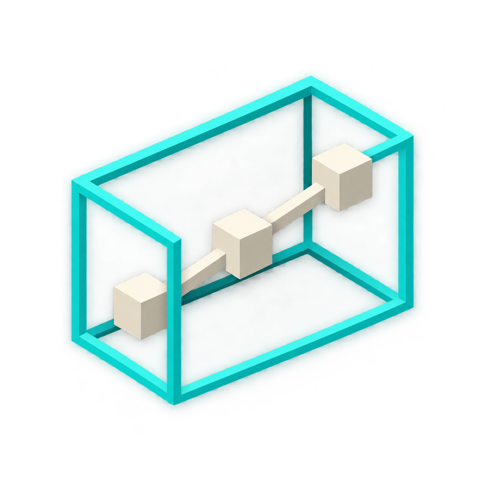
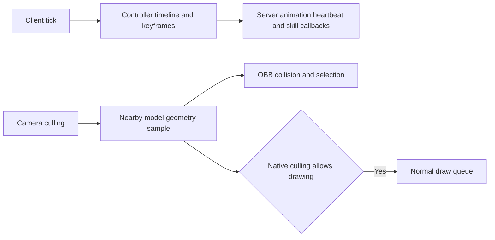

# BoneHitboxLib

<p align="center"></p>

[English](README.md) | [简体中文](README.zh-CN.md)

A Minecraft library that derives oriented bounding boxes (OBBs) from model geometry. It provides part selection, combat and collision events, per-part state, model-based block shapes, and optional GeckoLib keyframe skills.

## Supported versions

| Minecraft | Library version | Loader | Java | Target project |
| --- | --- | --- | --- | --- |
| 26.2 | 0.3.0 | Fabric | 25 | [fabric-26.2](targets/fabric-26.2) |
| 26.2 | 0.3.0 | NeoForge | 25 | [neoforge-26.2](targets/neoforge-26.2) |
| 26.1.2 | 0.3.0 | Fabric | 25 | [fabric-26.1.2](targets/fabric-26.1.2) |
| 26.1.2 | 0.3.0 | NeoForge | 25 | [neoforge-26.1.2](targets/neoforge-26.1.2) |
| 1.21.1 | 0.3.0 | Fabric | 21 | [fabric-1.21.1](targets/fabric-1.21.1) |
| 1.21.1 | 0.3.0 | NeoForge | 21 | [neoforge-1.21.1](targets/neoforge-1.21.1) |
| 1.20.1 | 0.3.0 | Fabric | 17 | [fabric-1.20.1](targets/fabric-1.20.1) |
| 1.20.1 | 0.3.0 | Forge | 17 | [forge-1.20.1](targets/forge-1.20.1) |

All targets share the version-neutral code in `common/src/main` and select Minecraft- and loader-specific adapters from `common/src/compat`. Each `targets/<loader>-<minecraft>` directory is an independent Gradle project. Use matching Minecraft, loader and library builds on the client and server.

## Features

- **Model-derived entity geometry:** capture animated vanilla `ModelPart` cubes and optional GeckoLib cubes. Entities opt in through `BoneHitboxEntity`; selectors such as `ALL`, `BASE` and `HUMAN_BASE` choose actual model parts.
- **Part selection and combat:** ray selection, highlights, mutable `ATTACK`, `HURT` and `COLLISION` attributes, contact events and per-part data such as health.
- **Collision and carrying:** `NONE`, `SOFT` and `HARD` policies, continuous OBB collision handling and support for carrying entities. Held-item geometry follows item bounds and hand/model transforms.
- **Server queries and synchronization:** `ObbServerGeometry` exposes recent model-pose snapshots, including transforms, axes, half extents and vertices. State and extension data can be synchronized and persisted.
- **GeckoLib keyframe skills:** point markers and `BEGIN/TICK/END/CANCEL` windows, tracked-entity timeline updates outside the camera frustum, and server-side report deduplication.
- **Model-based blocks:** choose OBB or AABB geometry, derive occupied cells from model elements, and link placement, removal and interaction across a multi-block structure.

## Installation

Use the JAR for your Minecraft version and loader. Put it in `mods/` on both sides where the library is required. Fabric also requires its matching Fabric API and Forge Config API Port. GeckoLib is optional; install the matching version when using GeckoLib models or keyframe skills.

The [version and Maven coordinate guide](docs/versions/README.md) lists all eight target artifacts. Build the matching target project to produce an installable JAR. Files ending in `-sources.jar` or `-javadoc.jar` are developer artifacts, not installable mods.

## Maven coordinates

Version `0.3.0` is published under `com.kltyton`. The common API module is `bonehitboxlib-common-<minecraft>`; each loader module is `bonehitboxlib-<loader>-<minecraft>`. The loader artifact is the runtime mod JAR, while the common artifact supplies compile-time API types. Add the exact modules for the target you use to the Sighs Maven repository:

```groovy
repositories {
    exclusiveContent {
        forRepository { maven { url = 'https://maven.sighs.cc/repository/maven-public/' } }
        filter {
            includeModule('com.kltyton', 'bonehitboxlib-common-26.2')
            includeModule('com.kltyton', 'bonehitboxlib-neoforge-26.2')
        }
    }
}
dependencies {
    compileOnly 'com.kltyton:bonehitboxlib-common-26.2:0.3.0'
    runtimeOnly 'com.kltyton:bonehitboxlib-neoforge-26.2:0.3.0'
}
```

Replace `neoforge` and `26.2` with one of the loader/version pairs in the target table. The common API coordinate uses the same Minecraft version.

## Entity integration

For NeoForge 26.2, resolve the library from Sighs Maven:

```groovy
repositories {
    exclusiveContent {
        forRepository { maven { url = 'https://maven.sighs.cc/repository/maven-public/' } }
        filter { includeModule('com.kltyton', 'bonehitboxlib-neoforge-26.2') }
    }
}
dependencies {
    compileOnly 'com.kltyton:bonehitboxlib-common-26.2:0.3.0'
    runtimeOnly 'com.kltyton:bonehitboxlib-neoforge-26.2:0.3.0'
}
```

In 26.2, tracked GeckoLib controllers advance on client ticks while outside the camera view, and nearby culled models provide collision geometry through a separate deferred collector. Native distance and frustum checks use the sampled model bounds; sampled draw tasks never enter the normal draw queue. Frozen entities retain their paused animation state. Other target versions keep their previous behavior.



Implement `BoneHitboxEntity` and register the parts that participate. For example, the registration method can use:

```java
@Override
public void bonehitboxlib$registerObbBones(ObbBoneRegistrar registrar) {
    registrar.register(ObbBoneRegistrar.ALL)
            .collision(ObbCollisionMode.HARD)
            .dataFactory(
                    ObbBoneRegistrar.BASE,
                    ObbBuiltinDataKeys.PART_HEALTH,
                    () -> new ObbPartHealth(20.0F, 20.0F))
            .data(ObbBuiltinDataKeys.CARRIES_ENTITIES, true);
    registrar.register("right_arm").attack();
}
```

Use the actual bone names in your model. `dataFactory(BASE, ...)` selects the base part within the registration; `data(...)` applies to all selected parts. The built-in player integration uses `HUMAN_BASE`, which includes the base and held items. See the [registration and synchronization API](docs/server_sync_api.md) for imports, events and state handling.

## Block geometry configuration

Edit the loader-generated server configuration, `bonehitboxlib-server.toml`:

```toml
vanillaSlantedBlockObb = true
forceAllBlockObb = false
blockModelWhitelist = []
blockModelBlacklist = []
```

- `vanillaSlantedBlockObb`: use packaged model geometry for vanilla slanted blocks; enabled by default.
- `forceAllBlockObb`: enable OBB collision for all allowed blocks; disabled by default. Prefer packaged model elements and fall back to the block's own finite collision geometry. Originally empty collision stays empty.
- `blockModelWhitelist`: an empty list imposes no restriction. A non-empty list limits the affected block IDs.
- `blockModelBlacklist`: takes priority over the whitelist, including forced mode and library model blocks. Excluded library model OBBs use model AABBs.

Lists accept `namespace:id`, `namespace:*` and `*`. For example:

```toml
forceAllBlockObb = true
blockModelWhitelist = ["minecraft:*"]
blockModelBlacklist = ["minecraft:chest", "minecraft:trapped_chest"]
```

The whitelist limits scope; it does not enable a mode by itself. See [block shapes](docs/block_shapes.md) for configuration locations, automatic multi-cell blocks and integration examples. In 26.2, `ModelShapeCache.buildForElements(JsonArray, Direction)` and its result types are public for consumers that already have model elements.

## Building

The root uses the KltytonTemple `3cfe9ad` controller. Each `targets/<loader>-<minecraft>` project has its own Gradle Wrapper and declares its Java toolchain. To build one target, run its wrapper from that directory:

```powershell
cd .\targets\neoforge-26.2
.\gradlew.bat build
```

From the repository root, the controller exposes per-target `build_<target>` tasks and `buildAllTargets`; target names replace `-` and `.` with `_`:

```powershell
.\gradlew.bat build_neoforge_26_2
.\gradlew.bat buildAllTargets
```

On Linux or macOS, use `./gradlew` in place of `gradlew.bat`. Build outputs are in each target's `build/libs/`. The build generates vanilla block geometry from the pinned Minecraft assets. Existing authored runtime models, animations and textures remain regular resources.

## Operating boundaries

Entity poses and GeckoLib markers are client-assisted. The server validates tracking, registered keys, finite geometry, bounds and report budgets; integrations must authorize skills using their own server state. This is not a complete server-side animation simulation or anti-cheat system.

Block physics uses packaged model elements. Client resource packs, animated renderers and special rendering paths do not automatically redefine server collision. The packaged static model data does not describe shapes that change at runtime.


## Documentation

- [Registration, synchronization and events](docs/server_sync_api.md)
- [Client selection and highlights](docs/client_obb_selection.md)
- [Model-derived block shapes](docs/block_shapes.md)
- [Package layout and API migration](docs/package_layout.md)
- [Version and Maven coordinate guide](docs/versions/README.md)

## Acknowledgements

- **Eden Realm**: the implementation source for convex model geometry, cell clipping, automatic multi-cell placement, linked removal and interaction forwarding.
- **Mob Battle**: the reference for the GeckoLib keyframe reporting workflow.
- [Spark-Core](https://github.com/SolarMoonQAQ/Spark-Core): the design reference for separating logical animation updates from rendering. This library retains GeckoLib's animation evaluation and does not include Spark-Core's physics engine.
- [GeckoLib](https://github.com/bernie-g/geckolib): the foundation for optional skeletal animation, model and keyframe integration.
- [Fabric](https://fabricmc.net/), [NeoForge](https://neoforged.net/), [Minecraft Forge](https://minecraftforge.net/), [Forge Config API Port](https://github.com/Fuzss/forgeconfigapiport) and [MixinExtras](https://github.com/LlamaLad7/MixinExtras): loader, configuration and Mixin infrastructure.

Thanks to their authors and maintainers. Third-party project names and licenses belong to their respective owners.

## License

[LGPL-3.0-only](LICENSE).
